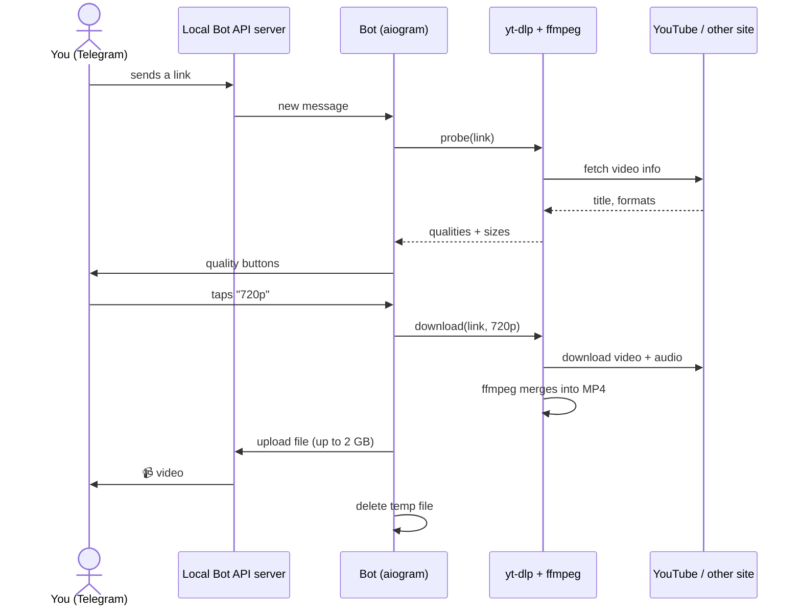

# YouTube Downloader Telegram Bot

A private Telegram bot that downloads videos from **YouTube** and **1000+ other sites**
(TikTok, Instagram, X/Twitter, Reddit, Dailymotion…) in the quality you choose, or as **MP3**.

Send a link → pick a quality → get the file in Telegram. Files up to **2 GB**.

```
You:  https://youtu.be/dQw4w9WgXcQ
Bot:  🎬 Never Gonna Give You Up
      👤 Rick Astley · ⏱ 3:33
      Choose quality:
      [1080p · ≈68.2 MB] [720p · ≈32.1 MB]
      [480p · ≈18.4 MB]  [360p · ≈11.9 MB]
      [        🎵 Audio (MP3)            ]
You:  *taps 720p*
Bot:  📹 Never Gonna Give You Up.mp4
```

## Features

- **Quality picker**: buttons for every available resolution (144p–4K), with the estimated file size
- **MP3**: audio only, 192 kbps
- **Up to 2 GB per file**, using Telegram's local Bot API server (the normal limit is 50 MB)
- **Works with 1000+ sites**, powered by [yt-dlp](https://github.com/yt-dlp/yt-dlp)
- **Private**: only Telegram users you list can use it
- **English and Russian**: replies in the user's Telegram app language
- **Plays everywhere**: prefers H.264 + AAC in MP4, so videos play inline on every Telegram client
- **Keeps working**: yt-dlp updates itself each time the bot starts
- **Docker Compose**: one command to start, restarts by itself after crashes or reboots

---

## How it works



1. **You send a link.** The bot finds the first URL in your message. It refuses links to private or internal
   addresses, so nobody can use the bot to reach the server's own network.
2. **The bot looks up the video.** yt-dlp fetches the list of formats without downloading anything. The bot groups
   them by resolution and estimates each one's size (video + audio).
3. **You get buttons.** Each button only carries a short random token (Telegram allows 64 bytes per button), which
   points to the video info the bot keeps in memory for 1 hour. Qualities bigger than the size limit are hidden.
4. **You tap a quality.** yt-dlp downloads the best video stream up to that resolution plus the best audio, and ffmpeg
   merges them into one MP4. For MP3 it downloads the audio and converts it.
5. **The bot uploads the file** to Telegram through the local Bot API server, then deletes it from the server's disk.

Limits that protect the server: each user can run **one download at a time**, and at most
`MAX_CONCURRENT_DOWNLOADS` downloads run at once in total.

### Why a "local Bot API server"?

Bots normally talk to `api.telegram.org`, which refuses uploads over **50 MB**. Telegram publishes the
[Bot API server](https://github.com/tdlib/telegram-bot-api) so you can run it yourself. In `--local` mode it accepts
uploads up to **2000 MB**. Docker Compose starts it next to the bot, and the bot talks to it instead of
`api.telegram.org`. It's not exposed to the internet.

---

## Project structure

```
youtube-bot/
├── bot/
│   ├── __main__.py          # Entry point: builds the bot, wires everything together, starts polling
│   ├── config.py            # Reads and validates settings from environment variables
│   ├── i18n.py              # All texts in English and Russian
│   ├── keyboards.py         # Quality buttons and their callback data
│   ├── middlewares.py       # Picks the user's language; blocks users not in ALLOWED_USER_IDS
│   ├── handlers/
│   │   ├── start.py         # /start and /help
│   │   └── download.py      # Link → buttons → download → send
│   ├── services/
│   │   ├── downloader.py    # yt-dlp wrapper (runs in worker threads, cleans up temp files)
│   │   ├── media.py         # Data models + pure logic: grouping formats, size estimates
│   │   ├── request_store.py # Short-lived memory linking button tokens to video info
│   │   └── job_limiter.py   # One download at a time per user
│   └── utils/
│       ├── urls.py          # Finds links in messages, blocks private/internal addresses
│       └── formatting.py    # File sizes, durations, safe filenames
├── tests/                   # pytest test suite (~99% coverage)
├── data/                    # Your cookies.txt goes here (not committed to git)
├── Dockerfile               # Python 3.12 + ffmpeg + Deno, runs as a non-root user
├── docker-entrypoint.sh     # Updates yt-dlp, then starts the bot
├── docker-compose.yml       # Bot + local Telegram Bot API server
├── .env.example             # Template for your settings
├── requirements.txt         # Runtime dependencies
└── requirements-dev.txt     # + test/lint tools
```

**Layers:** `handlers` deal with Telegram (messages, buttons), `services` deal with downloading and state,
`utils` are small pure helpers. Handlers get their dependencies (`settings`, `downloader`, `store`, `jobs`) injected
by aiogram's dispatcher, which keeps them easy to test with fakes.

**Tech stack:** Python 3.12 · [aiogram 3](https://docs.aiogram.dev/) · [yt-dlp](https://github.com/yt-dlp/yt-dlp) ·
ffmpeg · [Deno](https://deno.com/) (yt-dlp needs it to solve YouTube's JavaScript challenges) · Docker Compose

---

## Setup

### 1. Get what you need from Telegram

| What | Where | Goes into |
|---|---|---|
| **Bot token** | Message [@BotFather](https://t.me/BotFather) → `/newbot` → follow the steps | `BOT_TOKEN` |
| **Your user ID** | Message [@userinfobot](https://t.me/userinfobot). Or start the bot later: it replies to strangers with their ID | `ALLOWED_USER_IDS` |
| **API ID + hash** | Log in at [my.telegram.org](https://my.telegram.org) → *API development tools* → create an app (any name) | `TELEGRAM_API_ID`, `TELEGRAM_API_HASH` |

> The API ID/hash identify an "app", not your account's password. Still, keep them secret.

### 2. Prepare the VPS

Any Linux VPS with **1 GB RAM**, **1 CPU** and **10+ GB disk** works. Ubuntu 22.04/24.04 or Debian 12 recommended.
Install Docker:

```bash
curl -fsSL https://get.docker.com | sh
```

### 3. Download the bot and configure it

```bash
git clone https://github.com/<your-username>/youtube-bot.git
cd youtube-bot
cp .env.example .env
nano .env        # fill in BOT_TOKEN, ALLOWED_USER_IDS, TELEGRAM_API_ID, TELEGRAM_API_HASH
```

### 4. Move the bot to the local API server (once)

A bot token can only be active on one Bot API server at a time. Log it out of Telegram's cloud server
**once** before the first start (replace `<BOT_TOKEN>`):

```bash
curl https://api.telegram.org/bot<BOT_TOKEN>/logOut
```

You should see `{"ok":true,"result":true}`. The local server can use the token right away. (Going back to the cloud
server later is possible, but only after 10 minutes.)

### 5. Start

```bash
docker compose up -d --build
```

Check that it's running:

```bash
docker compose logs -f bot
```

You should see `Starting bot: api=http://telegram-bot-api:8081, file limit=2000 MB, allowed users=1`.
Open your bot in Telegram and send `/start`. 🎉

---

## Everyday commands

| Task | Command |
|---|---|
| See logs | `docker compose logs -f bot` |
| Restart (also updates yt-dlp) | `docker compose restart bot` |
| Stop | `docker compose down` |
| Update the bot after `git pull` | `docker compose up -d --build` |
| Add a friend | Add their ID to `ALLOWED_USER_IDS` in `.env`, then `docker compose up -d` |

---

## Configuration

All settings live in `.env`. See `.env.example` for a ready-to-copy template.

| Variable | Required | Default | What it does |
|---|---|---|---|
| `BOT_TOKEN` | ✅ | | Token from @BotFather |
| `ALLOWED_USER_IDS` | ✅ | | Telegram user IDs allowed to use the bot, comma-separated |
| `TELEGRAM_API_ID` | ✅ | | From my.telegram.org, for the local Bot API server |
| `TELEGRAM_API_HASH` | ✅ | | From my.telegram.org, for the local Bot API server |
| `MAX_FILE_SIZE_MB` | | `2000` | Largest file the bot sends. Max 2000 (local server) or 50 (cloud) |
| `MAX_CONCURRENT_DOWNLOADS` | | `2` | Downloads running at the same time, for all users together |
| `COOKIES_FILE` | | | Path to a cookies.txt *inside the container*, e.g. `/app/data/cookies.txt` |
| `YTDLP_AUTO_UPDATE` | | `true` | Update yt-dlp each time the container starts |
| `LOG_LEVEL` | | `INFO` | `DEBUG`, `INFO`, `WARNING` or `ERROR` |
| `TELEGRAM_API_URL` | | | Bot API server URL. Docker Compose sets this; leave empty to use the cloud API (50 MB limit) |
| `DOWNLOAD_DIR` | | `downloads` | Temporary download folder. Docker Compose sets this |

---

## Troubleshooting

### "🤖 The site is blocking this server" / *Sign in to confirm you're not a bot*

YouTube is suspicious of datacenter IP addresses (that is, VPS servers). Fix it by giving the bot cookies from a
logged-in YouTube session:

1. ⚠️ **Use a secondary Google account**, not your main one. Accounts used for downloading can get flagged.
2. Open a **private/incognito window**, log in to YouTube with that account, and open any video.
3. Export cookies in Netscape format with a browser extension such as *Get cookies.txt LOCALLY*
   (available for Chrome and Firefox; avoid extensions that upload your cookies anywhere).
4. **Close the private window right away** without logging out, so YouTube doesn't rotate those cookies.
5. Upload the file to the server as `data/cookies.txt`, then:

   ```bash
   chmod 644 data/cookies.txt
   echo "COOKIES_FILE=/app/data/cookies.txt" >> .env
   docker compose up -d
   ```

Cookies also fix **age-restricted** videos, and Instagram/X/Vimeo posts that need login. You can export cookies for
several sites into the same file. More details: [yt-dlp FAQ](https://github.com/yt-dlp/yt-dlp/wiki/FAQ#how-do-i-pass-cookies-to-yt-dlp)
and [YouTube extractor notes](https://github.com/yt-dlp/yt-dlp/wiki/Extractors#exporting-youtube-cookies).

### Downloads suddenly stopped working

Sites change often, and yt-dlp releases fixes within days. Restart the bot to get the latest version:

```bash
docker compose restart bot
```

### The bot doesn't answer at all

- `docker compose ps`: both containers should be `running` / `healthy`.
- `docker compose logs bot`: look for `Configuration error` (check `.env`) or `Unauthorized`
  (wrong `BOT_TOKEN`, or you skipped the [logOut step](#4-move-the-bot-to-the-local-api-server-once)).
- Make sure your ID is in `ALLOWED_USER_IDS`. If it isn't, the bot replies "This is a private bot" with your ID.

### "📦 The file is larger than the limit"

Choose a lower quality. The bot hides qualities that are clearly too big, but some sites don't report sizes in
advance, and the real file turns out bigger.

### Moving the bot back to the cloud API

Remove the `telegram-bot-api` service and `TELEGRAM_API_URL` from `docker-compose.yml`. The limit drops to 50 MB.
See Telegram's [Bot API docs](https://core.telegram.org/bots/api#using-a-local-bot-api-server) on switching
servers.

---

## Running without Docker (development)

You need Python 3.12+, ffmpeg and [Deno](https://docs.deno.com/runtime/getting_started/installation/) on your PATH.

```bash
python -m venv .venv
source .venv/bin/activate          # Windows: .venv\Scripts\activate
pip install -r requirements-dev.txt
cp .env.example .env               # BOT_TOKEN and ALLOWED_USER_IDS are enough
python -m bot
```

Without `TELEGRAM_API_URL`, the bot uses Telegram's cloud API with the 50 MB limit. Use a **separate test bot token**
if your main bot is already logged out to a local server.

### Tests and linting

```bash
pytest                 # runs all tests with a coverage report
ruff check .           # lint
ruff format .          # auto-format
```

The tests don't need the internet or a bot token: Telegram and yt-dlp are replaced by fakes.

---

## Security notes

- **Secrets** live only in `.env`, which is in `.gitignore`. **Never commit it.** If a token leaks, revoke it in
  @BotFather (`/revoke`).
- **Only allowlisted users** can use the bot. Everyone else gets a "private bot" reply.
- **Links to private networks are refused** (localhost, `10.x`, `192.168.x`, Docker service names, hostnames that
  resolve to private IPs). This stops the bot from being used to reach the server's internal services. Redirects that
  yt-dlp follows aren't checked, which is one more reason to keep the bot private.
- **The bot container runs as a normal user**, not root, and never sees the Telegram API hash.
- **The local Bot API server isn't exposed** to the internet: it has no published ports.

## Legal

This project is for **personal use**. Downloading content may violate the terms of service of YouTube and other
sites, and copyright law in your country. Only download content you have the right to download. The authors take no
responsibility for how this software is used.
